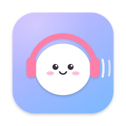
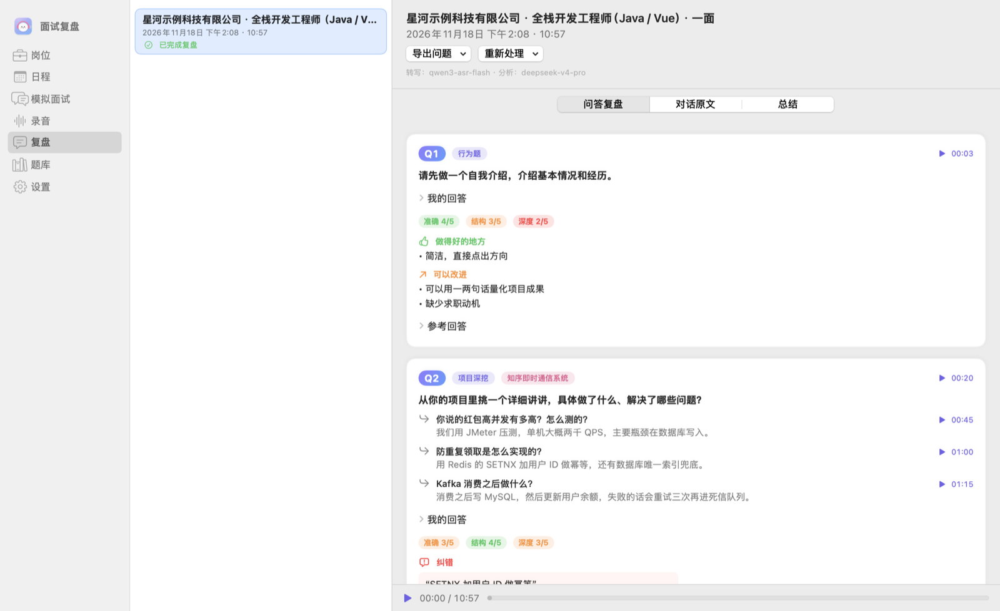
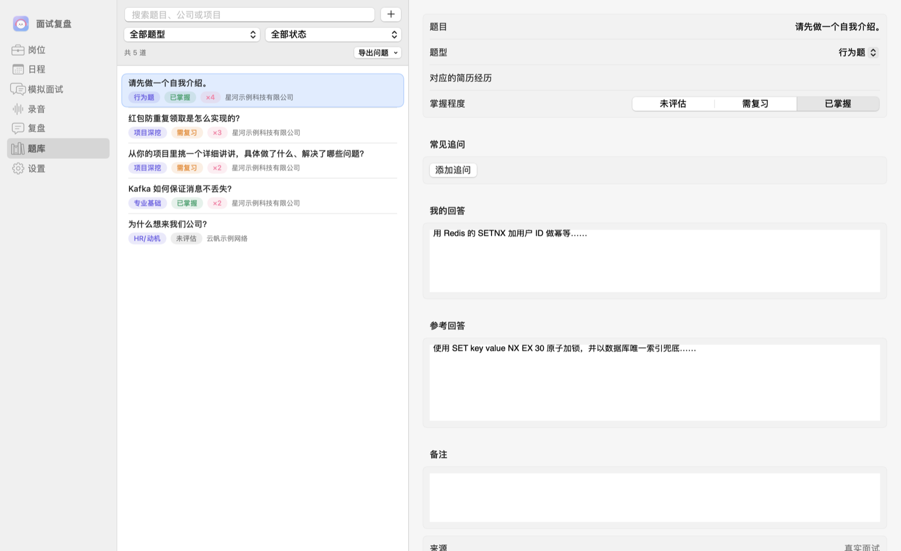
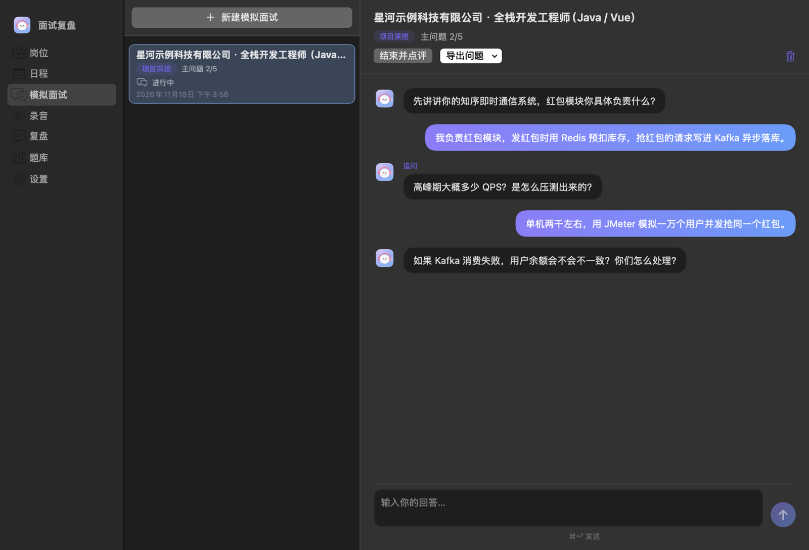
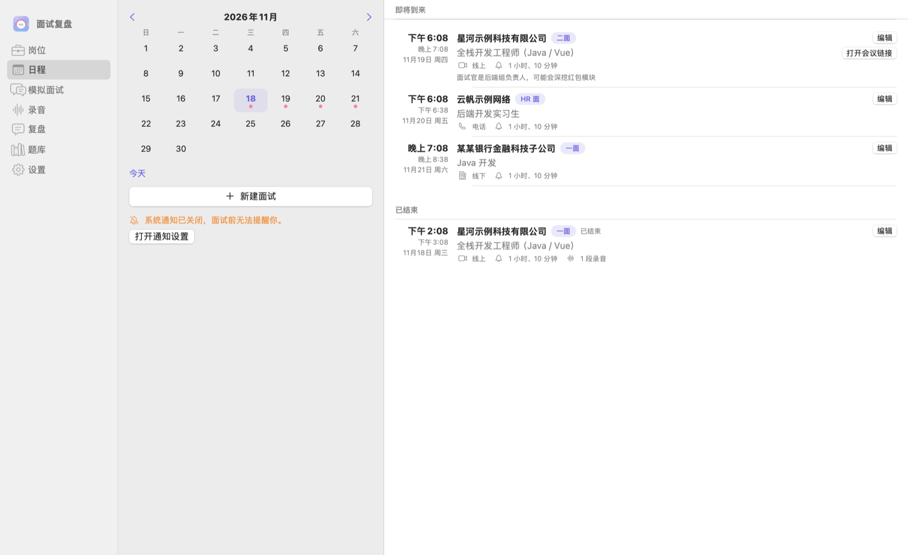
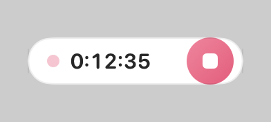

# Debrief（面试复盘）

[简体中文](README.md) | **English**

A macOS app for job seekers: record your interviews, get an AI review of every question you were asked, and turn them into a question bank you can practise with.

## What it does

- **Record any online interview.** Zoom, Teams, Tencent Meeting, a browser tab: Debrief records the meeting audio and your microphone on separate tracks. A small floating button sits above the meeting window and stays out of screen sharing. If the app crashes or the Mac sleeps, the recording is saved.
- **Review.** The recording is transcribed with the speakers told apart (interviewer / you). An AI model then finds every question and follow-up, scores your answer (accuracy, structure, depth), points out factual mistakes, and writes a better answer using only your real experience from your resume. Click any question to hear that moment.
- **Question bank.** Questions from every review collect in one place. Repeats are merged and counted ("asked ×3"), and each one is marked 已掌握 / 需复习 from your latest answer.
- **Mock interviews.** An AI interviewer asks questions based on the job description, your resume and the real questions you've been asked before, follows up like a real interviewer, then reviews you the same way.
- **Applications and schedule.** Keep track of companies, roles, JDs and resume versions. Schedule rounds with reminders; the reminder has a 开始录音 button that starts recording linked to that interview.

| Question bank | Mock interview (dark mode) | Schedule |
|---|---|---|
|  |  |  |

Interface languages: 简体中文 (default), 繁體中文, English, 日本語.

## Install

Requires **macOS 15** or later.

1. Download the latest `Debrief-<version>.dmg` from [Releases](../../releases) and drag **面试复盘** into Applications.
2. If macOS says the app "can't be opened" (builds without notarization): open **System Settings → Privacy & Security**, scroll down and click **Open Anyway**.
3. On the first recording, allow **Microphone** and **Screen & System Audio Recording**. Debrief only uses the screen permission to capture system audio; it never saves any video. After granting it, quit and reopen the app.

Prefer to build it yourself? See [ARCHITECTURE.md](ARCHITECTURE.md#build-run-test).

## Set up the AI models

Reviews and mock interviews need API keys. Open **设置 → 模型服务**:

- **Transcription:** Alibaba Cloud Model Studio (`qwen3-asr-flash`).
- **Review, mock interviews, question bank:** DeepSeek by default. Any OpenAI-compatible service works (OpenAI, a local Ollama, …), and each feature can use a different model.

Press **Test** next to each one to check the key with one tiny real request. Keys are stored in your macOS Keychain.

Recording, the schedule, applications and the question bank work without any key.

## Privacy

- Recordings stay on your Mac in `~/Movies/Debrief/`. All other data is in `~/Library/Application Support/Debrief/`.
- When you start a review, the speech segments of that recording are sent to your transcription provider, and the transcript plus the job description and resume go to your review model. Mock interviews send the job description, resume and your typed answers to the mock-interview model. Silence is never uploaded. Nothing is sent anywhere else, and there are no analytics.
- **Only record with consent.** Recording people without their consent is illegal in many places. Debrief asks you to confirm this before your first recording.

## Floating button

Click to start or stop, drag to move, right-click for more. While recording it shows the elapsed time and a level ring, and a green check once the file is saved. Clicking it doesn't take focus away from the meeting. It asks macOS to keep it out of screen sharing, but check this with your meeting app before relying on it.

## For developers

- [ARCHITECTURE.md](ARCHITECTURE.md): building, testing, releases, how recording and the AI review work, data layout.
- [CLAUDE.md](CLAUDE.md): rules for AI coding assistants working in this repo.
