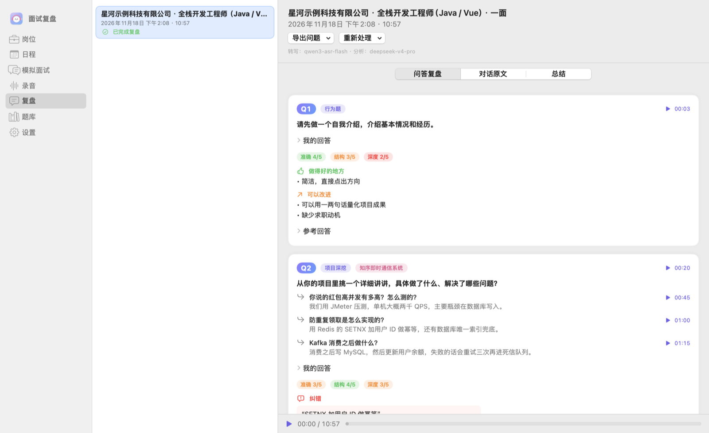
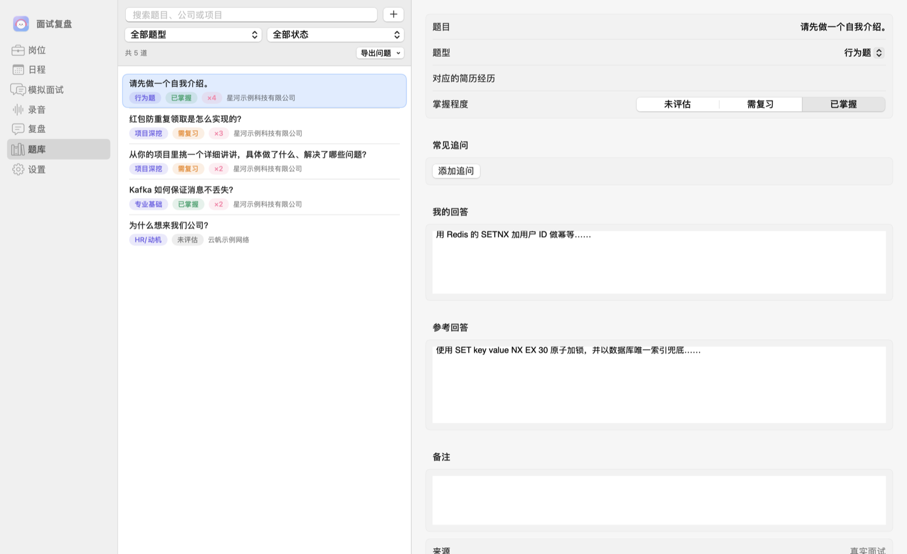
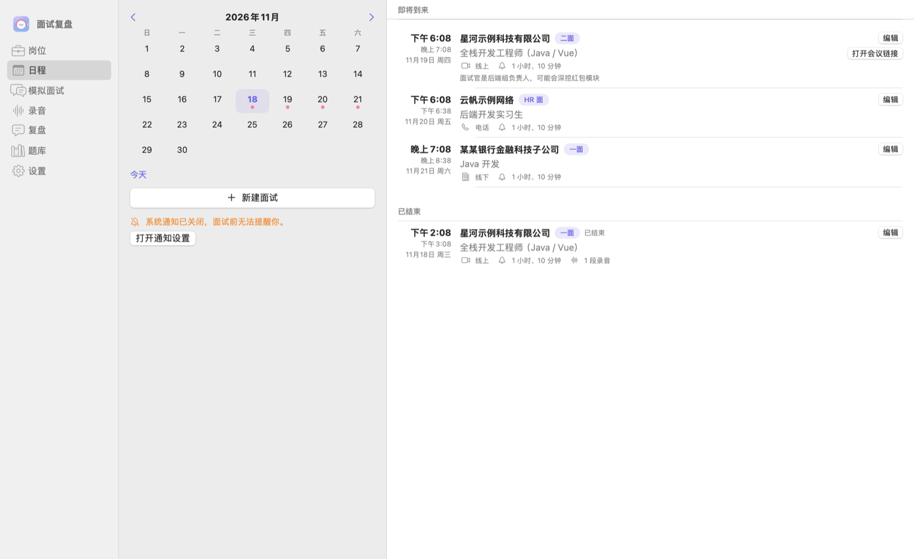
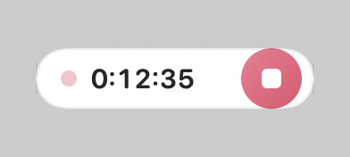

# Debrief（面试复盘）

**简体中文** | [English](README.en.md)

写给求职者的 macOS App：录下每一场面试，AI 逐题帮你复盘，把被问过的问题沉淀成题库，再拿来做模拟面试。

## 功能

- **录制线上面试。** 腾讯会议、Zoom、Teams、浏览器里的面试都能录。会议声音和你的麦克风分轨保存。录音时有一个小悬浮按钮浮在会议窗口上方，并且会请求系统不把它显示在屏幕共享里。App 崩溃或 Mac 睡眠时，已录的内容会自动保存。
- **复盘。** 录音转成文字时会区分面试官和你。AI 会找出每一个问题和追问，从准确、结构、深度三方面给你的回答打分，指出事实错误，并且只用你简历里的真实经历写一份参考回答。点击任意一道题，可以直接跳到录音里的那一刻收听。用手机或会议软件录好的文件（音频或视频）也可以导入后复盘；这类只有一条音轨的录音，可以在设置里开启实验功能"自动区分说话人"。
- **题库与每日复习。** 每次复盘的问题自动收进题库。重复的问题会合并并计数（如"被问 ×3"）。答得不好的题第二天会再出现，答得好的间隔会逐渐拉长（3、7、14、30、60 天）。题库页显示"今天待复习 N 道"，点一下就能开始：逐题作答，AI 当场点评，每次的得分都会记录下来。
- **模拟面试。** AI 面试官根据岗位描述（JD）、你的简历和你真实被问过的问题来出题，会像真人一样追问，结束后用同样的标准给你点评。
- **岗位与日程。** 记录投递的公司、岗位、JD 和所用的简历版本。安排面试轮次并设置提醒，提醒通知里有"开始录音"按钮，点击后开始录音，录音会自动关联到这场面试。

| 题库 | 模拟面试（深色模式） | 日程 |
|---|---|---|
|  |  |  |

界面语言：简体中文（默认）、繁體中文、English、日本語。

## 安装

需要 **macOS 15** 或更高版本。

1. 从 [Releases](../../releases) 下载最新的 `Debrief-<版本号>.dmg`，把**面试复盘**拖进"应用程序"文件夹。
2. 如果 macOS 提示"无法打开"（未经公证的版本会这样）：打开**系统设置 → 隐私与安全性**，滚动到底部，点击**仍要打开**。
3. 第一次录音时，允许**麦克风**和**屏幕与系统录音**权限。屏幕权限只用来录系统声音，不会保存任何画面。授权后退出 App 再重新打开。

想自己从源码构建？见 [ARCHITECTURE.md](ARCHITECTURE.md#build-run-test)。

## 配置 AI 模型

打开**设置 → 模型服务**：

- **转写**：在 macOS 26 及以上版本，默认用**本机识别**（Apple 系统自带的语音识别）。免费，不需要 API Key，录音不会离开你的 Mac；第一次使用时会自动下载语言模型。中英混说时英文术语容易认错，比较在意的话可以切换到**云端模型**：阿里云百炼（`qwen3-asr-flash`）。
- **复盘、模拟面试、题库**：默认使用 DeepSeek。任何兼容 OpenAI 接口的服务都可以用（OpenAI、本地 Ollama 等），每个功能可以分别指定不同的模型。

每一项旁边都有**测试**按钮，会用一次极小的真实请求检查 Key 是否可用。Key 保存在 macOS 钥匙串里。

复盘分析、题库练习和模拟面试需要文本模型的 API Key。不配置任何 Key 时，录音、转写（本机识别）、日程、岗位管理和题库也都可以正常使用。

## 隐私

- 录音只保存在你的 Mac 上，位置是 `~/Movies/Debrief/`。其他数据都在 `~/Library/Application Support/Debrief/`。
- 开始复盘时，如果用本机识别，转写全程在你的 Mac 上完成；如果用云端模型，录音中有人说话的片段会发给你配置的转写服务。转写文本连同 JD 和简历会发给你配置的复盘模型；题库练习会把题目、你的回答、JD 和简历发给复盘模型。模拟面试会把 JD、简历和你输入的回答发给模拟面试模型。静音部分不会上传。除此之外不会向任何地方发送数据，也没有任何统计或埋点。
- **录音前务必征得对方同意。** 在很多地方，未经同意录音是违法的。第一次录音前，App 会要求你确认这一点。

## 悬浮按钮

单击开始或停止录音，拖动可以移动位置，右键打开更多选项。录音时按钮上显示已录时长和音量圈，保存完成后会出现绿色对勾。点击按钮不会把焦点从会议窗口抢走。它会请求系统不在屏幕共享中显示自己，但正式使用前，请先在你的会议软件里确认一下。

## 开发者

- [ARCHITECTURE.md](ARCHITECTURE.md)：构建、测试、发布，录音和 AI 复盘的实现，数据布局（英文）。
- [CLAUDE.md](CLAUDE.md)：AI 编程助手在本仓库中的工作规则。
