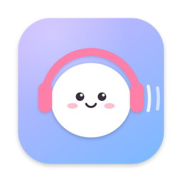

# Debrief（面试复盘）



macOS 15+ app that helps job seekers review interviews. Today it records an interview or meeting: system audio (Zoom, Teams, the browser) plus your microphone. Each source goes to its own track in a crash-safe file. When you stop, the tracks are mixed down to one `.m4a`.


## Build and run

Needs Swift 6 (Command Line Tools are enough, no Xcode required).

```sh
./build-app.sh                       # → build/Debrief.app
open build/Debrief.app
swift run RecorderSelfTest           # headless test of write / crash-recovery / mixdown
```

On the first recording, macOS asks for **Microphone** and **Screen & System Audio Recording** access. After granting screen access, quit and reopen the app. Don't use `swift run Debrief`: without the bundle's Info.plist, macOS kills the process when it asks for the microphone.

### Keep permissions across rebuilds

macOS ties Microphone and Screen & System Audio Recording permission to the app's code signature. Ad-hoc builds get a new signature every time, so after a rebuild recording fails even though System Settings still shows the app as allowed. To fix it once:

1. Open Keychain Access → menu Keychain Access → Certificate Assistant → Create a Certificate…
2. Name: `Debrief Dev`, Identity Type: Self Signed Root, Certificate Type: **Code Signing** → Create.
3. Rebuild with `./build-app.sh`. It picks up the certificate automatically. Grant permissions once more; after that they stay granted across rebuilds.

Until then, after each rebuild run `tccutil reset ScreenCapture dev.local.InterviewRecorder` and `tccutil reset Microphone dev.local.InterviewRecorder`, then grant again.

## Behaviour

- Output: `~/Movies/Debrief/Interview-yyyy-MM-dd-HHmmss.m4a` (or `~/Movies/InterviewRecorder/` if it exists from before the rename) (AAC, 48 kHz stereo). The folder can be changed in the window.
- While recording: `Interview-….inprogress.mov`, flushed every 2 s. If the app crashes, it is recovered into an `.m4a` on the next launch, losing at most about 2 s.
- Floating record button: always on top, on every Space and over full-screen meeting apps. Click to start/stop, drag to move (position remembered), right-click for a menu. Shows elapsed time and a level ring while recording, and a green check once saved. Clicking doesn't take focus from the meeting window. Show/hide from the main window, the menu bar, or its right-click menu. It asks macOS to leave it out of screen sharing, but check this with your meeting app before relying on it.
- Sleep, a capture error, or quitting the app stops the recording and saves it.
- Mic volume in the mix can be adjusted. The raw tracks stay separate until the mixdown.
- UI languages: 简体中文 (default), 繁體中文, English, 日本語, plus "Follow System". Switch at the bottom of the window; the change applies immediately. System-drawn UI (open panel, permission prompts) follows on the next launch. "Follow System" falls back to Simplified Chinese when the system language isn't supported.
- A consent dialog appears before the first recording.

## App structure

Main window sidebar: **岗位** (applications: company, role, status, JD, resume version, notes) · **录音** · **设置** (模型服务 / 个人资料 / 通用).

- Data: `~/Library/Application Support/Debrief/` (`applications.json`, `resumes.json`, `profile.json`, `ai-settings.json`, `Resumes/` copies of imported files). If a file can't be read, a copy is kept as `*.unreadable-<time>.json` before the app starts fresh.
- API keys: login Keychain, service `dev.local.Debrief.api-key`. With ad-hoc builds macOS may ask for your login password the first time a new build reads a key ("Always Allow" stops it until the next rebuild). The `Debrief Dev` certificate above avoids this too.
- AI providers (default = budget plan): DeepSeek (`deepseek-v4-pro` for review, `deepseek-flash` for mock interviews and the question bank), Alibaba Cloud Model Studio `qwen3-asr-flash` for transcription. Every feature can be pointed at another provider/model in 设置 → 模型服务; "Test" makes one minimal real call.
- Schedule (日程): month calendar + upcoming/past lists; interviews have round, time, duration, format (online link / address / phone), notes and reminders (1 day, 1 h, 30 min, **10 min** default, 5 min). Reminders are local notifications, delivered even when the app isn't running, with buttons 开始录音 (records, linked to that interview) and 打开会议链接. Scheduling an interview moves its application from 已投递 to 面试中.
- Recording ↔ interview: a recording is linked to the scheduled interview whose window (30 min before start → 30 min after planned end) contains its start time, closest start first. It can be changed while recording and afterwards (录音 → 录音记录). Index: `recordings.json`.
- Each recording keeps `Interview-….tracks.mov` next to the `.m4a`: the original per-source tracks (system = interviewer, mic = you) for per-speaker transcription. About 130 MB per hour.
- Review (复盘), per recording, saved as `Reviews/<recordingID>.json`:
  1. Transcribe: each track of `.tracks.mov` is decoded to 16 kHz mono and split into speech segments (`RecorderCore/SpeechSegmenter`: energy-based, pauses < 0.8 s merged, ≤ 30 s per segment, silence never sent). Segments go to Qwen-ASR 4 at a time with retries; JD/resume terms are passed as recognition context. Mic lines that duplicate the interviewer (no headphones) are dropped.
  2. Analyze with the review model (JSON mode): extract questions + follow-ups by transcript line numbers → critique in batches of 4 (corrections, strengths, improvements, a better answer built only from the candidate's real experience, 3 scores) → summary. Line numbers are validated, scores clamped, invalid JSON retried once.
  3. Every step is saved as it finishes; "继续分析" resumes. Transcript lines can be edited (text and speaker), then 重新分析.
- Question bank (题库, `question-bank.json`): questions from finished reviews and mock interviews are added automatically. A question whose text is ≥ 55 % similar (character bigrams) to an existing one is merged into it (asked ×N, follow-ups merged). Mastery comes from the latest critique: average ≥ 4 with no corrections → 已掌握, otherwise 需复习. Filter by category / mastery / text; export the filtered list.
- Mock interview (模拟面试, `MockInterviews/<id>.json`): pick an application (JD + resume), a type and 3–10 main questions. The interviewer model asks one question at a time (JSON turns: question / followUp / end, with category and resume item), follows up 0–2 times, and is seeded with real questions from the bank (same application → same company → same resume item → still to review). The app enforces the question count. "结束并点评" reuses the review critique and summary, then adds the questions to the bank. "导出问题" copies or saves the questions asked so far (main + follow-ups only) in the same Markdown format as review exports.
- Tests can set `DEBRIEF_TEST_API_KEY` so API calls use that key instead of reading the Keychain (for mock servers).
- UI snapshots without screen-recording permission: `python3 scripts/make_demo_data.py /tmp/demo <any .m4a>` then `DEBRIEF_DATA_DIR=/tmp/demo DEBRIEF_SNAPSHOT_DIR=/tmp/shots build/Debrief.app/Contents/MacOS/Debrief` renders every page at 900×600, 1300×820 and 1100×720 dark, plus the floating button, and quits (no visible window, no reminders).
- Visual style: colours and shared card/label/pill styles live in `Sources/Debrief/UI/Theme.swift`, derived from the icon.
- Tests: set `DEBRIEF_DATA_DIR=/some/scratch/dir` so nothing touches real data (`$HOME` doesn't redirect it).
- No SwiftData / `@State` / `@Observable`: those need Xcode's macro plugins, which Command Line Tools don't ship. Use `ObservableObject` + `@Published` instead.

## Localization

All copy lives in one table in `scripts/gen_strings.py`. After editing it, run:

```sh
python3 scripts/gen_strings.py Resources   # regenerates Resources/<lang>.lproj/{Localizable,InfoPlist}.strings
```

To add a language, add a column to the table and its code to `L` in the script, to `AppLanguage` / `shippedCodes` in `Sources/Debrief/Localization.swift`, and to `CFBundleLocalizations` in `Resources/Info.plist`. Recording people without their consent is illegal in many places.

## App icon

`Resources/AppIcon.icns` comes from `scripts/make_icon.swift`, option **buddy** (a round buddy wearing headphones, lavender → sky blue with pink accents; the app's colours in `UI/Theme.swift` follow it). `swift scripts/make_icon.swift /tmp/icon all` renders all three drafted options plus a comparison sheet. To rebuild the icon:

```sh
swift scripts/make_icon.swift /tmp/icon buddy && mkdir -p /tmp/icon/AppIcon.iconset && \
for s in 16 32 128 256 512; do sips -z $s $s /tmp/icon/AppIcon-buddy-1024.png --out /tmp/icon/AppIcon.iconset/icon_${s}x${s}.png; \
  sips -z $((s*2)) $((s*2)) /tmp/icon/AppIcon-buddy-1024.png --out /tmp/icon/AppIcon.iconset/icon_${s}x${s}@2x.png; done && \
iconutil -c icns /tmp/icon/AppIcon.iconset -o Resources/AppIcon.icns
```

The bundle id stays `dev.local.InterviewRecorder` so settings saved before the rename (language, consent, mic volume) carry over. Change it when you get a real developer account.
